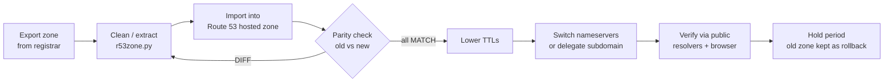
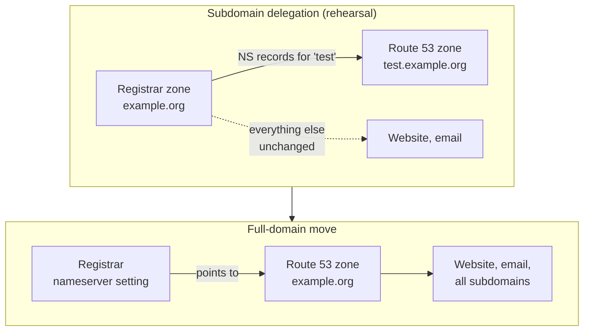

# Zero-downtime DNS migration: registrar DNS → Amazon Route 53

[](https://github.com/adijain-99/route53-dns-migration/actions/workflows/ci.yml)


[](LICENSE)

A practical, field-tested playbook and toolkit for moving DNS hosting from a
domain registrar (here, 123 Reg) to **Amazon Route 53** without taking websites
or email offline.

It came out of a real migration of a portfolio of ~25 domains with live web
apps, Google Workspace email and several third-party mail senders. All
company-specific details have been removed; examples use `example.org`.

## The idea in one picture

DNS is a signpost, not the shop. The migration builds an identical signpost at
Route 53, proves it is identical, and only then swaps signposts. During the swap
some resolvers read the old one and some the new one, and because they say the
same thing, nobody notices.



## Two ways to move



Start by delegating one low-risk subdomain to prove the process on a real
domain, then move whole domains, lowest risk first (parked domains, then
redirect-only, then those carrying live sites and email).

## Three rules that prevent downtime

1. **Copy the signpost exactly.** Every record goes into Route 53 unchanged, and
   an automated parity check compares both providers record by record.
2. **Don't take the old signpost down.** Leave the old zone untouched through a
   hold period. Rollback is pointing back to it.
3. **Don't move the shop on the same day.** DNS moves on one day; website
   launches or hosting changes happen on another.

## What's in this repo

| Path | What it is |
|---|---|
| [`docs/runbook-subdomain-delegation.md`](docs/runbook-subdomain-delegation.md) | Rehearsal: move one subdomain (e.g. `test.example.org`) to Route 53 without touching the rest of the domain |
| [`docs/runbook-full-domain.md`](docs/runbook-full-domain.md) | Move a whole domain, including email records, in 2–3 working days |
| [`docs/lessons-learned.md`](docs/lessons-learned.md) | The things that nearly went wrong, and how to avoid them |
| [`docs/plan-template.md`](docs/plan-template.md) | A 5-step milestone plan to share with stakeholders |
| [`scripts/r53zone.py`](scripts/r53zone.py) | Turns a registrar zone export into a Route 53 import-ready file (full domain or one subdomain) and lists the names to verify |
| [`scripts/Compare-DnsParity.ps1`](scripts/Compare-DnsParity.ps1) | Parity check for Windows/PowerShell: old vs new nameserver, per record type, with Alias handling |
| [`scripts/check-parity.sh`](scripts/check-parity.sh) | The same check for macOS/Linux using `dig` |
| [`iam/route53-migration-policy.json`](iam/route53-migration-policy.json) | Scoped IAM policy for doing the migration |
| [`examples/`](examples/) | A fictional registrar export to try the tooling on |
| [`tests/`](tests/) | Unit tests for `r53zone.py` |
| [`.github/workflows/ci.yml`](.github/workflows/ci.yml) | CI: Python tests (3.9, 3.12), ShellCheck, PSScriptAnalyzer |

## Quick start

```bash
# 1. Export the zone from the registrar (123 Reg: Manage DNS → Actions → Export Zone File)

# 2a. Whole domain: clean the export for Route 53
python3 scripts/r53zone.py full examples/example.org.export.txt --out example.org.zone

# 2b. Or just one subdomain, to delegate it on its own
python3 scripts/r53zone.py subdomain examples/example.org.export.txt --sub test --out test.zone

# 3. Paste the .zone file into Route 53 → hosted zone → Import zone file
#    (do any "NEEDS ACTION" items the script printed by hand)

# 4. Parity check: old provider's nameserver vs one of the Route 53 nameservers
./scripts/check-parity.sh test.zone.names.txt ns1.old-provider.example ns-123.awsdns-45.net
```

Windows:

```powershell
./scripts/Compare-DnsParity.ps1 -NamesFile test.zone.names.txt `
    -OldServer ns1.old-provider.example -NewServer ns-123.awsdns-45.net
```

Only cut over when every line says `MATCH`.

## Scope

In scope: moving **DNS hosting** (the records) to Route 53.

Out of scope, deliberately: transferring the **domain registration**, and moving
**mailboxes** or **website hosting**. Those are separate projects, best done
after DNS is stable. Route 53 does not host mailboxes; keep them with your mail
provider and point the MX records at it.

## Requirements

- Python 3.9+ (standard library only) for `r53zone.py`
- PowerShell 5.1+/7+ (`Resolve-DnsName`, Windows) or `dig` (macOS/Linux) for the parity check
- An AWS role with the permissions in `iam/route53-migration-policy.json`

## Development

```bash
python3 -m unittest discover -s tests -v   # unit tests
shellcheck scripts/check-parity.sh         # shell lint
```

## License

MIT, see [LICENSE](LICENSE).
