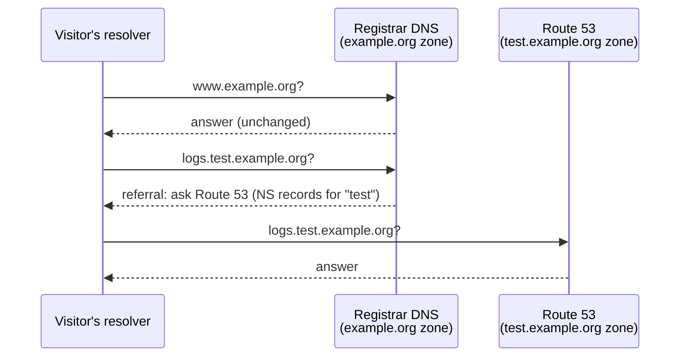

# Runbook: move one subdomain to Route 53 (rehearsal)

Move `test.example.org` to Route 53 while `example.org` itself, its website and
its email stay at the current provider. This is the safest way to rehearse the
process on a real domain with real records.

**How it works:** the parent zone at the registrar gets NS records for `test`
that point at a separate Route 53 hosted zone. Only names ending in
`test.example.org` are affected.

**Typical duration:** 1–2 hours hands-on.



---

## 1. Find every record that moves

Everything **at or below** the subdomain moves with it: `test`, `mb.test`,
`logs.test`, and certificate validation records such as `_abc123.test` or
`_def456.logs.test`. Names that merely contain the word (`test2`, `test-dr`,
`testwebapp`) do **not** move.

```bash
python3 scripts/r53zone.py subdomain example.org.export.txt --sub test --out test.zone
```

The script prints how many records live under the subdomain and anything that
needs manual work. Don't eyeball a screenshot for this; work from the full
export.

## 2. Create the hosted zone

Route 53 → Hosted zones → **Create hosted zone**

- Domain name: `test.example.org`
- Type: **Public hosted zone**

Note its 4 nameservers. Create it in the AWS account that will own all your
production DNS, not a development account.

## 3. Import the records

Hosted zone → **Import zone file** → paste `test.zone`.

The zone must contain only NS and SOA before the import, or the import fails.

## 4. Create the apex record by hand

`test.example.org` is now the **apex** of its own zone, where a CNAME is not
allowed. Recreate it as an **Alias**:

- Record name: *(blank)*
- Type: **A**, Alias **on**
- Route traffic to: *Alias to Application and Classic Load Balancer* (or CloudFront)
- Region and target: the same load balancer the old CNAME pointed to

If the load balancer is in another AWS account it won't be in the dropdown.
Type its name (`dualstack.<lb-name>.<region>.elb.amazonaws.com`) and choose
**Use: "…"**. Check the ID carefully: a similarly named production load
balancer may be the one pre-selected.

## 5. Parity check

```bash
./scripts/check-parity.sh test.zone.names.txt <old-provider-ns> <one-route53-ns>
```

Every line must be `MATCH`. The apex shows as `ALIAS`: Route 53 answers with
IPs where the old provider answered with a CNAME, so the script compares IP sets.

## 6. Delegate at the registrar

In the **parent** zone (`example.org`) at the registrar:

1. Add **4 NS records**, name `test`, one per Route 53 nameserver, lowest TTL offered.
2. If the registrar refuses because the `test` CNAME exists, delete that CNAME
   and **immediately** add the NS records. Have them ready to paste.
3. Leave the other `*.test` records in the parent zone for now. Once delegated,
   resolvers ignore them, and they are your rollback copy.

> The gap between deleting the CNAME and adding the NS records is the only
> moment the subdomain is unreachable. Any resolver that looks it up in that
> window may cache "not found" for up to the SOA minimum TTL (often 1 hour),
> so keep the gap to seconds.

## 7. Verify

```powershell
Resolve-DnsName test.example.org -Server 8.8.8.8
Resolve-DnsName test.example.org -Server 1.1.1.1
```

- The apex now returns **IPs directly** (no CNAME): proof Route 53 is answering.
- Open every site under the subdomain in a browser; check the padlock.
- If only your own machine fails, flush its cache: `ipconfig /flushdns`.

## Rollback (≈10 minutes)

Delete the 4 NS records for `test` in the parent zone and re-add the original
`test` CNAME. The old `*.test` records are still there.

## Later: when the parent domain moves

Before switching `example.org` itself to Route 53, add the same 4 `test` NS
records to the **`example.org` hosted zone** in Route 53, or the delegation is
lost and the subdomain stops resolving.
